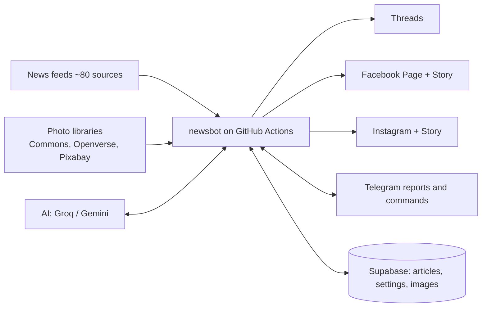
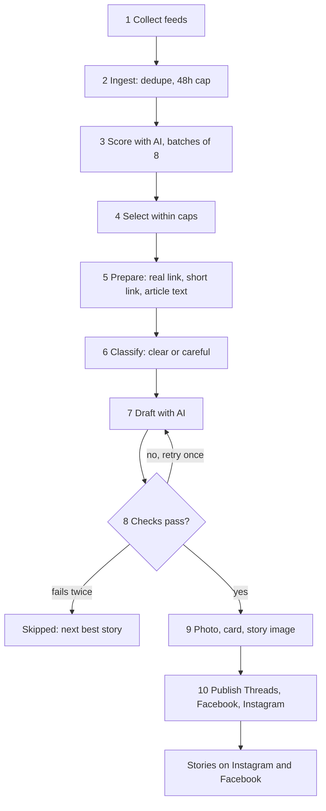
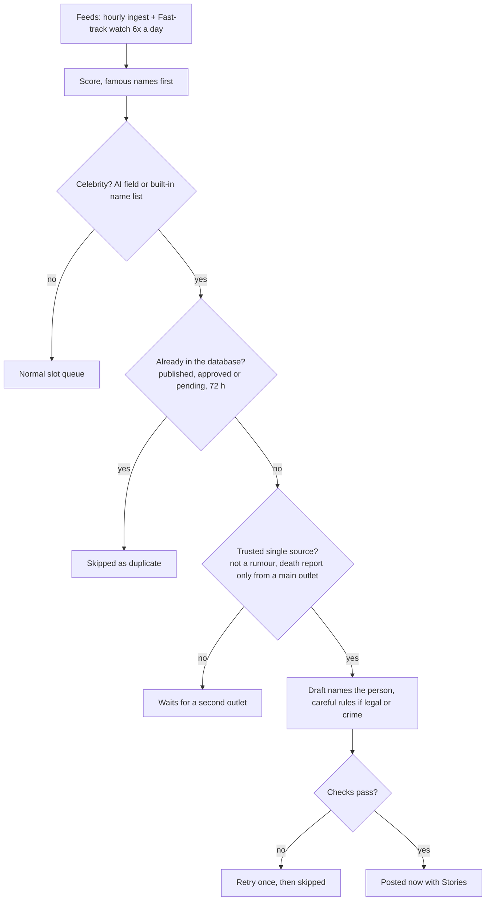
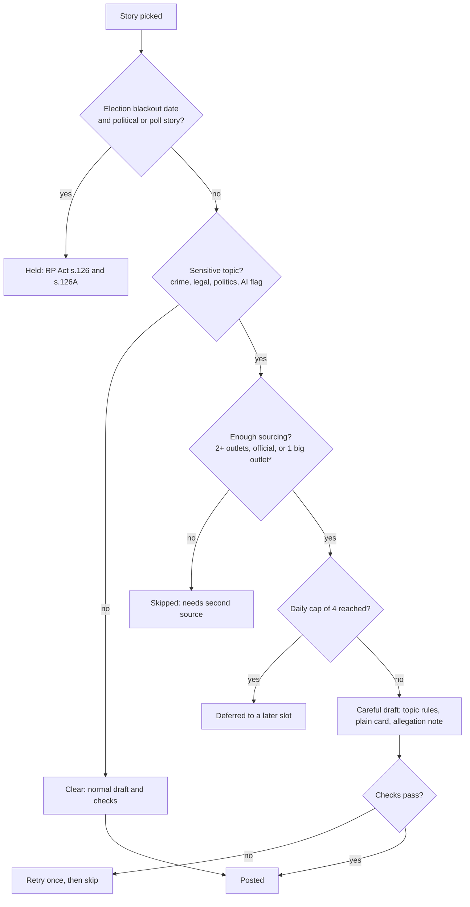

# India In Short – Project Documentation

India In Short is a fully automated, free, India-only news desk. It picks the day's most important India stories, rewrites them in plain, neutral language, checks them, and posts them to Threads, Facebook and Instagram (plus Instagram and Facebook Stories) with a licensed photo and a short source link. Brand: India In Short, @indiainshort.daily (Instagram, Threads), indiainshort.news (Facebook Page). English only.

Last updated: 21 Oct 2026. The editable version with drawn flowcharts is the "India In Short – Project Documentation" doc in Claude; this file is the repository copy with Mermaid diagrams.

## 1. At a glance

| Item | Value |
| --- | --- |
| Runs on | GitHub Actions (scheduler), Supabase (database + image bucket), Groq and Gemini (AI), Telegram (control and reports) |
| Volume | Up to 8 posts a day, 2 per slot, 4 slots, plus an evening digest |
| Cost | Free tiers only |
| Principles | Neutral on parties, religions, communities; facts only; human voice; source link on every post; extra care on sensitive stories |

## 2. Architecture

| Part | Role | Files |
| --- | --- | --- |
| Feeds | PIB, national outlets, state-scoped Google News, specialist and region-specific outlets (North-East, J&K, Ladakh, Odisha, Punjab, Goa, Karnataka and more), fact-checkers (Alt News, BOOM, Factly, Newschecker, Vishvas News, FactCrescendo). Each new feed has a Google News site: fallback | `sources.py`, `ingest.py` |
| AI | Batch scoring, human-voice drafting | `ai.py` |
| Safety | Tiers, topic rules, draft checks | `safety.py` |
| Orchestration | Ingest, selection, drafting, publishing, Telegram commands | `pipeline.py` |
| Photos and cards | Licensed photos, 1080x1350 cards, 1080x1920 story images | `photos.py`, `cards.py` |
| Links | Resolve Google News links, shorten, fetch text for fact context | `media.py` |
| Platforms | Threads, Facebook, Instagram, Stories, tokens | `meta.py` |
| Storage | Articles, settings, bucket | `db.py`, `schema.sql` |
| Control | Alerts, commands, run logs | `telegram.py`, `runlog.py` |

## 3. Schedule (IST)

| Workflow | When | What it does |
| --- | --- | --- |
| Ingest | Hourly | Reads feeds, dedupes, scores with AI, deletes data older than 72 h |
| Publish slot | 07:35, 12:35, 18:35, 21:05 | Selects, drafts, checks, posts, posts Stories |
| Digest | 22:10 | "Today in short" carousel |
| Fast-track watch | 6 times a day: 08:00, 12:00, 16:00, 20:00 IST (day), 00:30 and 04:30 IST (night) | Reads entertainment, sports, business and main national feeds; posts celebrity and urgent/critical stories right away |
| Telegram approvals | Every 5 min | Commands and buttons |
| Health | Daily 18:10, weekly Monday 08:45 | Tokens, dead feeds |
| Keepalive | 1st and 15th of month | Keeps schedules active |
| Diagnose | On demand | Full check of tokens, feeds, photos and Stories |
| Clean old runs | Weekly, Sunday 08:30 | Deletes Actions run history older than 7 days |

Pipeline workflows share one concurrency group. GitHub may start a run 15–30 min late.

## 4. The story pipeline

## 5. Ranking and selection

`combined = 0.35 x significance + 0.30 x impact + 0.35 x interest + bonuses`

Bonuses: critical (significance 8+) +0.5, important (impact 8+) +0.3, trending search in India +0.6 (+1.0 with 100K+ searches). Outrage never raises a score.

Limits: 8 posts/day, 2 per slot, one story per category per slot; breaking (score 8.8+, 2+ outlets) max 2/day; politics max 2/day; careful stories max 4/day; Spotlight (specialist, regional or official sources not yet carried by big outlets, civic value 6.0+, waited 2 h) max 1/day; nothing older than 48 h. A skipped story is replaced by the next best, up to 4 rounds.

### Celebrity fast-track

Stories about well-known people (film, TV and music stars, cricketers and other athletes, influencers, business leaders, authors; not politicians, officials or religious leaders) skip the slot queue and post as soon as they are scored and checked.

- Detection: the AI scorer returns a `celebrity` name; `celebrities.py` is the backup list (extend it any time). The name is kept in the story's `draft` field, so no database change is needed.
- Bar: minimum score 3.5 instead of 5.5, plus 0.8. Opinion, promotional and non-India items are still dropped.
- Sources: one main outlet, an official source or a fact-checker is enough; a regional or specialist source is enough unless the story is a death or illness report (hoax risk). Rumour wording ("reportedly", "dating", "sources say") needs two outlets.
- Legal and crime stories about a celebrity can go out on one trusted source, in careful wording: the person may be named as the subject, every allegation is attributed to police, the complaint or the court, no guilt labels. Sexual-offence and minor cases still need two outlets or an official source, and survivors, minors and families are never identified.
- The person is named in the headline and every post text (otherwise the draft is retried) and is the first hashtag, except on careful crime stories.
- Urgent and critical news uses the same fast lane (`breaking_pass`): significance 9+, or 8+ with an emergency word in the headline (lockdown, curfew, evacuation, earthquake, cyclone, terror attack, stampede, war, nationwide...), carried by one trusted source (main outlet, official, fact-checker) or by 2+ outlets; the older rule (score 8.8+ with 2+ outlets) still applies. Cap `MAX_BREAKING_PER_DAY` 3. Careful-topic rules and the election-silence block still apply.
- The hourly ingest also runs both fast lanes, so a celebrity or urgent story waits at most about an hour even between watch runs.
- One post per person per topic: a later development about the same person within 24 hours is a follow-up. It gets a Story only (no feed post), at most 2 a day (`STORY_ONLY_PER_DAY`); the rest are skipped. A critical update (death or critical illness, conviction or sentence, retirement) is allowed one more post per person per day. Urgent news follows the same idea: a second urgent story in the same state and category within 12 hours is a Story only.
- Cap: 3 fast-track posts a day (`CELEBRITY_PER_DAY`), separate from the 8 regular posts and the 4 careful posts. Switch off with `CELEBRITY_FAST=0`.
- Photos: the person-free photo rule is unchanged, so these posts use a place or scene photo or the plain card, never a photo of the celebrity.

## 6. Safety and legal rules

\* One big national outlet is enough for accidents, shootings, disasters and politics; sexual-offence, minor, pending-case and communal stories always need a second outlet or an official source.

Only the election blackout (dates in `ELECTION_SILENCE`) is a hard stop. Careful topic rules (`safety.TOPIC_RULES`):

- Sexual offence and minors: never identify the survivor or child (no family, school, village, colony); state or district only; no accused name before conviction (BNS s.72, POCSO s.23, JJ Act s.74).
- Suicide: no method, place or note; Tele-MANAS 14416 helpline added.
- Communal or mob violence: official facts only, no community labels or blame.
- Pending cases: what the court did, no view on guilt or merits.
- Polls: declared results only.

Checks: every number appears in the source; names matched (one stray name tolerated with thin source text); no URLs, phone numbers, emails, IDs; no loaded words, engagement bait, shouting, more than 2 emoji; careful stories also reject guilt labels, named accused, emotive words, suicide methods. A failed draft is retried once, then skipped. This is a working policy, not legal advice.

## 7. Drafting, links, hashtags, photos

- Voice: plain, key fact first, no clickbait; states facts directly, never "according to" and never names the outlet; officials named as speakers of claims; accused are "alleged".
- Source: `Source: <short link>` (publisher URL resolved from Google News, tracking removed, shortened with is.gd, TinyURL backup; outlet name if it cannot be resolved). On Facebook the first comment, posted by the Page, adds `Read the full story: <full publisher URL>` where it is clickable. This needs the `pages_manage_engagement` permission; if missing, the run report says so and the post is unaffected.
- Hashtags (mandatory): Instagram 5 (2 topic, place, #IndiaNews, #IndiaInShort), Facebook 3, Threads 1 (Threads shows it without the #). Careful stories skip brand and category tags.
- Photos, places and scenes only: Wikimedia Commons (CC0, PD, CC BY) → Openverse → Pixabay (places, buildings, nature, travel, backgrounds only) → Pexels → plain card. A word filter rejects people, portraits and religion. A location filter keeps photos Indian: the search always names India or the story's state, and the picture's own tags, title and description must mention India, a state or a major city and must not name a foreign place (New York, London, Dubai...); if nothing passes, the plain card is used. Credits go in the caption ("Representative photo: ..."). The image carries only headline, category, region and handle. Careful stories always use the plain card.

## 8. Platform outputs

| Output | Format | Contents |
| --- | --- | --- |
| Threads | Image post, 500 chars | Body, source link, credit, 1 tag |
| Facebook | Photo post | Body, notes, source link, credit, 3 tags |
| Instagram | 1080x1350 card, caption up to 2,100 chars | Body, notes, source link (not clickable), credit, 5 tags |
| Stories (IG and FB) | 1080x1920 image | Headline over photo, category, handle |
| Digest | Swipeable carousel on Instagram and Threads (cover + one slide per story); Facebook text | The day's top stories. Threads text lists whole headlines (no cut-offs) and says "+N more in the slides" when not all fit; if Meta rejects the Threads carousel, the cover image is posted alone |

Stories post after the feed post succeeds; a Story failure is a warning and never blocks the feed post. `STORIES=0` turns them off. Instagram Stories are limited to 6 a day (`IG_STORIES_PER_DAY`) and pause during the Instagram cool-down. Each post remembers which Stories went out; skipped ones are made up by the hourly ingest and the fast-track watch (after the cool-down, for posts up to 6 hours old, once the Instagram feed post is live). The skip reason shows in the run report, and `/status` shows Stories today and any cool-down.

## 9. Data model

Tables `articles` (one row per story: URL unique, scores, flags, status, draft JSON, card URL, per-platform results) and `settings` (mode, pause flag, tokens, heartbeats); public bucket `cards`. Status flow: new → candidate or discarded → published, failed, expired (pending_review in review mode). Rows and images older than 72 h are deleted each ingest run; published rows stay as the record, their images are removed.

## 10. Telegram

Every run reports what ran, what was chosen, why anything was skipped, AI usage, queue and errors. Publish, digest and diagnose reports are also saved (secrets removed) to the GitHub issue "Run errors". Commands: `/status`, `/pause`, `/resume`, `/auto`, `/review`, `/retry <id>`, `/retract <id>`, `/fbtoken <token>` (message auto-deleted), `/help`. Owner chat only.

## 11. Configuration and secrets

Secrets are GitHub Actions secrets only and are redacted from logs: `SUPABASE_URL`, `SUPABASE_SERVICE_KEY`, `SUPABASE_BUCKET`, `GROQ_API_KEY`, `GEMINI_API_KEY`, `TELEGRAM_BOT_TOKEN`, `TELEGRAM_CHAT_ID`, `THREADS_USER_ID`, `THREADS_ACCESS_TOKEN`, `FB_PAGE_ID`, `FB_PAGE_TOKEN`, `IG_USER_ID`, `IG_TOKEN`, `FB_APP_ID`, `FB_APP_SECRET`, optional `PIXABAY_API_KEY`, `PEXELS_API_KEY`, and `ELECTION_SILENCE` (for example `[["2026-11-01","2026-11-03"]]`, IST, inclusive).

Tunables: `MAX_POSTS_PER_DAY` 8, `MAX_POSTS_PER_SLOT` 2, `MAX_CAREFUL_PER_DAY` 4, `CELEBRITY_PER_DAY` 3, `STORY_ONLY_PER_DAY` 2, `CELEBRITY_MIN_SCORE` 3.5, `CELEBRITY_FAST` 1, `MAX_POLITICS_PER_DAY` 2, `ARTICLE_MAX_AGE_HOURS` 48, `DATA_RETENTION_HOURS` 72, `STORIES` 1, `IG_COOLDOWN_MINUTES` 90, `IG_MIN_GAP_SECONDS` 60, `IG_STORIES_PER_DAY` 6, `USE_PHOTOS` 1, `REPORT_LEVEL`, `DEFAULT_MODE` auto.

## 12. Operations

On demand (GitHub → Actions → Run workflow): Diagnose, Publish slot, Clean old runs.

| Symptom | Likely cause | Fix |
| --- | --- | --- |
| Nothing posted in a slot | All picks failed facts or safety checks | Read the slot report; skips are named |
| Error 190, token expired | FB/IG token expired | `/fbtoken` with a fresh token |
| Facebook error 200 publish_actions | User token instead of Page token | `/fbtoken`, then `/retry <id>` |
| AI error 429 | Free-tier quota | Automatic fallback model |
| Instagram "Application request limit reached" (code 4, sub 2207051) on the publish step | Usually Instagram's anti-spam block on automated posting, not a call count; Instagram may even publish the post while reporting the error | Automatic: Instagram publishing pauses 90 min; publishes are at least 60 s apart; Instagram Stories are capped at 3 a day; before any retry the bot checks the account's latest posts and never posts the same caption twice; retries for up to 12 h (4 tries); the warning shows Instagram's own 24 h publish count. The Retry button also works |
| Photo missing | No licensed person-free match | Plain card, no action |
| Outlet name instead of link | Google News link not resolved | Cosmetic |

126 automated tests cover ingest, scoring, caps, safety, checks, hashtags, photos, cards, Stories, tokens, cleanup and Telegram.

## 13. Known limits and ideas

Limits: Threads renders its hashtag without #; the facts check is strict (expect about 4–5 posts a day); Instagram links are not clickable; shortened links can reduce reach on Facebook and Instagram; election dates are entered by hand; GitHub schedules can run up to about 30 min late; free AI tiers can hit quota.

Ideas: weekly reach report after about 4 weeks; one lawyer review of the sensitive-topic policy; reply to comments in the first hour (manual).
