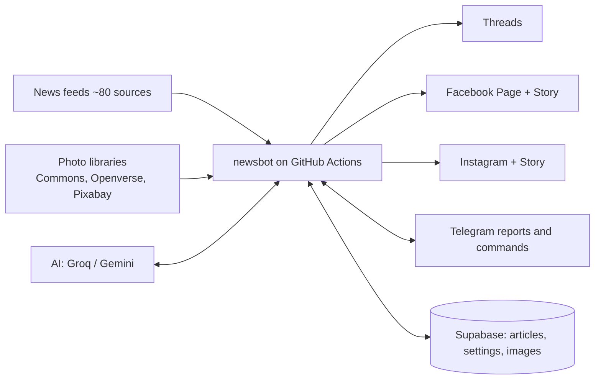
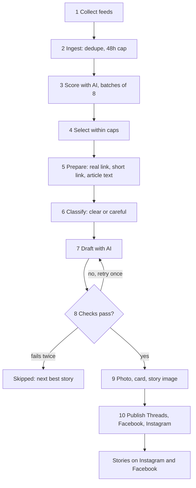
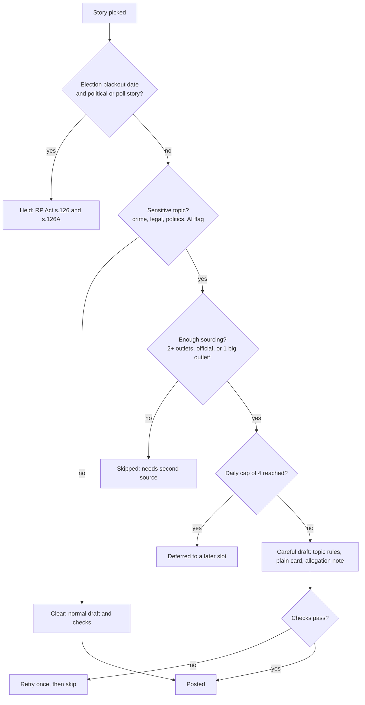

# India In Short – Project Documentation

India In Short is a fully automated, free, India-only news desk. It picks the day's most important India stories, rewrites them in plain, neutral language, checks them, and posts them to Threads, Facebook and Instagram (plus Instagram and Facebook Stories) with a licensed photo and a short source link. Brand: India In Short, @indiainshort.daily (Instagram, Threads), indiainshort.news (Facebook Page). English only.

Last updated: 19 Oct 2026. The editable version with drawn flowcharts is the "India In Short – Project Documentation" doc in Claude; this file is the repository copy with Mermaid diagrams.

## 1. At a glance

| Item | Value |
| --- | --- |
| Runs on | GitHub Actions (scheduler), Supabase (database + image bucket), Groq and Gemini (AI), Telegram (control and reports) |
| Volume | Up to 8 posts a day, 2 per slot, 4 slots, plus an evening digest |
| Cost | Free tiers only |
| Principles | Neutral on parties, religions, communities; facts only; human voice; source link on every post; extra care on sensitive stories |

## 2. Architecture

| Part | Role | Files |
| --- | --- | --- |
| Feeds | PIB, national outlets, state-scoped Google News, specialist and region-specific outlets (North-East, J&K, Ladakh, Odisha, Punjab, Goa, Karnataka and more), fact-checkers (Alt News, BOOM, Factly, Newschecker, Vishvas News, FactCrescendo). Each new feed has a Google News site: fallback | `sources.py`, `ingest.py` |
| AI | Batch scoring, human-voice drafting | `ai.py` |
| Safety | Tiers, topic rules, draft checks | `safety.py` |
| Orchestration | Ingest, selection, drafting, publishing, Telegram commands | `pipeline.py` |
| Photos and cards | Licensed photos, 1080x1350 cards, 1080x1920 story images | `photos.py`, `cards.py` |
| Links | Resolve Google News links, shorten, fetch text for fact context | `media.py` |
| Platforms | Threads, Facebook, Instagram, Stories, tokens | `meta.py` |
| Storage | Articles, settings, bucket | `db.py`, `schema.sql` |
| Control | Alerts, commands, run logs | `telegram.py`, `runlog.py` |

## 3. Schedule (IST)

| Workflow | When | What it does |
| --- | --- | --- |
| Ingest | Hourly | Reads feeds, dedupes, scores with AI, deletes data older than 72 h |
| Publish slot | 07:35, 12:35, 18:35, 21:05 | Selects, drafts, checks, posts, posts Stories |
| Digest | 22:10 | "Today in short" carousel |
| Telegram approvals | Every 5 min | Commands and buttons |
| Health | Daily 18:10, weekly Monday 08:45 | Tokens, dead feeds |
| Keepalive | 1st and 15th of month | Keeps schedules active |
| Diagnose | On demand | Full check of tokens, feeds, photos and Stories |
| Clean old runs | Weekly, Sunday 08:30 | Deletes Actions run history older than 7 days |

Pipeline workflows share one concurrency group. GitHub may start a run 15–30 min late.

## 4. The story pipeline

## 5. Ranking and selection

`combined = 0.35 x significance + 0.30 x impact + 0.35 x interest + bonuses`

Bonuses: critical (significance 8+) +0.5, important (impact 8+) +0.3, trending search in India +0.6 (+1.0 with 100K+ searches). Outrage never raises a score.

Limits: 8 posts/day, 2 per slot, one story per category per slot; breaking (score 8.8+, 2+ outlets) max 2/day; politics max 2/day; careful stories max 4/day; Spotlight (specialist, regional or official sources not yet carried by big outlets, civic value 6.0+, waited 2 h) max 1/day; nothing older than 48 h. A skipped story is replaced by the next best, up to 4 rounds.

## 6. Safety and legal rules

\* One big national outlet is enough for accidents, shootings, disasters and politics; sexual-offence, minor, pending-case and communal stories always need a second outlet or an official source.

Only the election blackout (dates in `ELECTION_SILENCE`) is a hard stop. Careful topic rules (`safety.TOPIC_RULES`):

- Sexual offence and minors: never identify the survivor or child (no family, school, village, colony); state or district only; no accused name before conviction (BNS s.72, POCSO s.23, JJ Act s.74).
- Suicide: no method, place or note; Tele-MANAS 14416 helpline added.
- Communal or mob violence: official facts only, no community labels or blame.
- Pending cases: what the court did, no view on guilt or merits.
- Polls: declared results only.

Checks: every number appears in the source; names matched (one stray name tolerated with thin source text); no URLs, phone numbers, emails, IDs; no loaded words, engagement bait, shouting, more than 2 emoji; careful stories also reject guilt labels, named accused, emotive words, suicide methods. A failed draft is retried once, then skipped. This is a working policy, not legal advice.

## 7. Drafting, links, hashtags, photos

- Voice: plain, key fact first, no clickbait; states facts directly, never "according to" and never names the outlet; officials named as speakers of claims; accused are "alleged".
- Source: `Source: <short link>` (publisher URL resolved from Google News, tracking removed, shortened with is.gd, TinyURL backup; outlet name if it cannot be resolved). On Facebook the first comment, posted by the Page, adds `Read the full story: <full publisher URL>` where it is clickable. This needs the `pages_manage_engagement` permission; if missing, the run report says so and the post is unaffected.
- Hashtags (mandatory): Instagram 5 (2 topic, place, #IndiaNews, #IndiaInShort), Facebook 3, Threads 1 (Threads shows it without the #). Careful stories skip brand and category tags.
- Photos, places and scenes only: Wikimedia Commons (CC0, PD, CC BY) → Openverse → Pixabay (places, buildings, nature, travel, backgrounds only) → Pexels → plain card. A word filter rejects people, portraits and religion. Credits go in the caption ("Representative photo: ..."). The image carries only headline, category, region and handle. Careful stories always use the plain card.

## 8. Platform outputs

| Output | Format | Contents |
| --- | --- | --- |
| Threads | Image post, 500 chars | Body, source link, credit, 1 tag |
| Facebook | Photo post | Body, notes, source link, credit, 3 tags |
| Instagram | 1080x1350 card, caption up to 2,100 chars | Body, notes, source link (not clickable), credit, 5 tags |
| Stories (IG and FB) | 1080x1920 image | Headline over photo, category, handle |
| Digest | Instagram carousel (3–5 slides) | The day's top stories |

Stories post after the feed post succeeds; a Story failure is a warning and never blocks the feed post. `STORIES=0` turns them off.

## 9. Data model

Tables `articles` (one row per story: URL unique, scores, flags, status, draft JSON, card URL, per-platform results) and `settings` (mode, pause flag, tokens, heartbeats); public bucket `cards`. Status flow: new → candidate or discarded → published, failed, expired (pending_review in review mode). Rows and images older than 72 h are deleted each ingest run; published rows stay as the record, their images are removed.

## 10. Telegram

Every run reports what ran, what was chosen, why anything was skipped, AI usage, queue and errors. Publish, digest and diagnose reports are also saved (secrets removed) to the GitHub issue "Run errors". Commands: `/status`, `/pause`, `/resume`, `/auto`, `/review`, `/retry <id>`, `/retract <id>`, `/fbtoken <token>` (message auto-deleted), `/help`. Owner chat only.

## 11. Configuration and secrets

Secrets are GitHub Actions secrets only and are redacted from logs: `SUPABASE_URL`, `SUPABASE_SERVICE_KEY`, `SUPABASE_BUCKET`, `GROQ_API_KEY`, `GEMINI_API_KEY`, `TELEGRAM_BOT_TOKEN`, `TELEGRAM_CHAT_ID`, `THREADS_USER_ID`, `THREADS_ACCESS_TOKEN`, `FB_PAGE_ID`, `FB_PAGE_TOKEN`, `IG_USER_ID`, `IG_TOKEN`, `FB_APP_ID`, `FB_APP_SECRET`, optional `PIXABAY_API_KEY`, `PEXELS_API_KEY`, and `ELECTION_SILENCE` (for example `[["2026-11-01","2026-11-03"]]`, IST, inclusive).

Tunables: `MAX_POSTS_PER_DAY` 8, `MAX_POSTS_PER_SLOT` 2, `MAX_CAREFUL_PER_DAY` 4, `MAX_POLITICS_PER_DAY` 2, `ARTICLE_MAX_AGE_HOURS` 48, `DATA_RETENTION_HOURS` 72, `STORIES` 1, `USE_PHOTOS` 1, `REPORT_LEVEL`, `DEFAULT_MODE` auto.

## 12. Operations

On demand (GitHub → Actions → Run workflow): Diagnose, Publish slot, Clean old runs.

| Symptom | Likely cause | Fix |
| --- | --- | --- |
| Nothing posted in a slot | All picks failed facts or safety checks | Read the slot report; skips are named |
| Error 190, token expired | FB/IG token expired | `/fbtoken` with a fresh token |
| Facebook error 200 publish_actions | User token instead of Page token | `/fbtoken`, then `/retry <id>` |
| AI error 429 | Free-tier quota | Automatic fallback model |
| Photo missing | No licensed person-free match | Plain card, no action |
| Outlet name instead of link | Google News link not resolved | Cosmetic |

91 automated tests cover ingest, scoring, caps, safety, checks, hashtags, photos, cards, Stories, tokens, cleanup and Telegram.

## 13. Known limits and ideas

Limits: Threads renders its hashtag without #; the facts check is strict (expect about 4–5 posts a day); Instagram links are not clickable; shortened links can reduce reach on Facebook and Instagram; election dates are entered by hand; GitHub schedules can run up to about 30 min late; free AI tiers can hit quota.

Ideas: weekly reach report after about 4 weeks; one lawyer review of the sensitive-topic policy; reply to comments in the first hour (manual).
