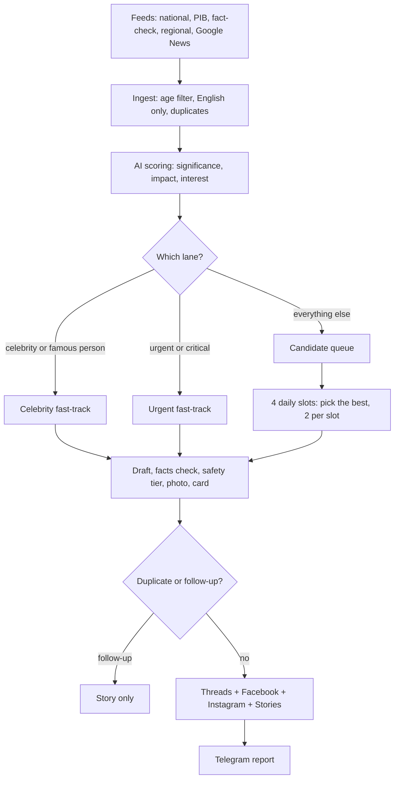

# India In Short: automated, neutral, AI-assisted India news desk

Watches about 100 Indian news feeds (national outlets, PIB and RBI, fact-checkers, regional and specialist outlets, and Google News searches for every state and UT), removes duplicates, scores stories, writes short human-voice English summaries, checks them, and posts to **Threads, Facebook and Instagram** (plus **Instagram and Facebook Stories**) with a licensed photo and a short source link. Runs free on GitHub Actions + Supabase + Groq/Gemini + Telegram.

**Start here:** [SETUP.md](SETUP.md) · **Full documentation with flowcharts:** [DOCUMENTATION.md](DOCUMENTATION.md) · **Before going live:** [COMPLIANCE.md](COMPLIANCE.md) · **Reach playbook:** [GROWTH.md](GROWTH.md)

Brand: India In Short, `@indiainshort.daily` (Instagram, Threads), `indiainshort.news` (Facebook Page). English only, India only, neutral on parties, religions and communities.

## How it works



1. **Ingest** (hourly): reads the feeds, drops stories older than 48 h, non-English headlines and junk, merges the same story from different outlets, and counts how many outlets carry it.
2. **Score**: Groq (then Gemini as failover) rates significance, impact and interest, and tags category, state, opinion, promo and sensitivity. `combined = 0.35·significance + 0.30·impact + 0.35·interest`, plus small bonuses for trending in India, critical and important stories.
3. **Select**: below 5.5 is discarded. Four slots a day pick the best stories within caps (below).
4. **Write and check**: the AI drafts per platform from the article text (never copying sentences, never naming the outlet). A facts-only check rejects any number or name not in the source, URLs, personal data, loaded words, engagement bait and shouting. One retry, then the next best story takes the place.
5. **Post**: each platform is posted on its own, so one failure never blocks the others. A short source link (`Source: is.gd/...`) and 1 to 5 hashtags are added automatically. Facebook also gets a first Page comment with the full publisher link, where it is clickable.
6. **Report**: every job sends a Telegram report with what happened and why anything was skipped.

## Schedules (GitHub Actions, IST)

| Workflow | When | What it does |
|---|---|---|
| `ingest.yml` | Hourly (:20) | Reads feeds, scores, runs both fast-track lanes, retries Instagram posts and Stories that were held back, deletes data older than 72 h |
| `publish.yml` | 07:35, 12:35, 18:35, 21:05 | Selects, drafts, checks, posts, posts Stories |
| `celebwatch.yml` | 08:00, 12:00, 16:00, 20:00, 00:30, 04:30 | Fast-track watch: reads entertainment, sports, business and main national feeds; posts celebrity and urgent stories right away |
| `digest.yml` | 22:10 | "Today in short" carousel (Instagram and Threads) from the day's posts |
| `poll.yml` | Every 5 min | Reads Telegram commands and button taps |
| `health.yml` | Daily 18:10, weekly Monday 08:45 | Platform check; weekly token refresh and feed check |
| `keepalive.yml` | 1st and 15th | Tiny commit so GitHub does not pause the schedules |
| `cleanup-runs.yml` | Sunday 08:30 | Deletes workflow run history older than 7 days |
| `diagnose.yml` | On demand | One-click full check (secrets by name, database, AI models, Telegram, Meta tokens, feeds) |

GitHub often starts a run 15 to 30 minutes late. The pipeline workflows share one concurrency group so they never run at the same time.

## Lanes and caps

| Lane | Rule | Cap per day |
|---|---|---|
| Regular slots | Best candidates by score; one story per category per slot; nothing older than 48 h | 8 posts (`MAX_POSTS_PER_DAY`), 2 per slot |
| Celebrity fast-track | Film, TV and music stars, cricketers and other athletes, influencers, business leaders (not politicians or officials). Lower score bar (3.5), one trusted source is enough, posts without waiting for a slot. Death or illness reports from non-mainstream sources and rumour-style stories wait for a second outlet. | 3 (`CELEBRITY_PER_DAY`), separate from the 8 |
| Follow-ups | A later development about the same celebrity within 24 h gets a Story only, no new post. Death, critical illness, conviction, sentence or retirement is allowed one more post. | 2 Stories (`STORY_ONLY_PER_DAY`) |
| Urgent fast-track | Significance 9+ (or 8+ with an emergency word such as lockdown, curfew, evacuation, earthquake, cyclone, stampede), one trusted source is enough; or score 8.8+ with 2+ outlets. A second urgent story in the same state and category within 12 h is a Story only. | 3 (`MAX_BREAKING_PER_DAY`) |
| Spotlight | One important story a day from specialist, regional or official sources that no big outlet has carried yet; always attributed, never called exclusive. | 1 |
| Politics | Keeps the feed balanced | 2 |
| Careful stories | Crime, legal, violence and sensitive topics under the strict rules below | 4 |

Every fast-track post is checked for duplicates against the last 72 hours of the database before it is posted.

## Safety and legal approach

Only one thing is blocked outright: the legal **election-silence window** for political and poll stories (Representation of the People Act s.126/126A), set with `ELECTION_SILENCE`. Every other sensitive topic is covered, not skipped, under **careful mode** with topic rules:

- **Sexual offence and minors:** never identify the survivor or child (no family, school, village); state or district only; no accused name before conviction.
- **Suicide:** no method, place or note; the Tele-MANAS 14416 helpline is added.
- **Communal or mob violence:** official facts only, no community labels or blame.
- **Pending cases, polls, religious flashpoints:** report what the court, agency or Election Commission did; no view on guilt, no forecasts.
- **All careful stories:** attributed wording ("police said"), "alleged"/"accused", no guilt labels, no emotive words, plain card (no photo), and a short allegation note.
- **Sourcing:** two outlets or an official source; one main outlet is enough for accidents, disasters, politics and (for celebrities) legal stories. Sexual-offence and minor stories always need two outlets or an official source.

This is a working policy, not legal advice; see [COMPLIANCE.md](COMPLIANCE.md).

## Posting, photos and Stories

- **Platforms:** Threads (image post, 500 characters), Facebook Page (photo post plus a first comment with the full link, which needs the `pages_manage_engagement` permission), Instagram (1080x1350 card, up to 2,100 characters), and a 1080x1920 **Story** on Instagram and Facebook after each feed post. Follow-ups get a Story only. A Story failure never blocks the feed post.
- **Instagram route:** Instagram posts through `graph.instagram.com` when an Instagram login token is saved (`/igtoken`, see SETUP.md), otherwise through the Facebook Page token. The Instagram login route has per-account limits and is recommended: the Facebook route can return "Application request limit reached" (code 4 / 2207051).
- **Instagram safeguards:** after that error the bot pauses Instagram publishing for 90 minutes, checks whether the post went live anyway (so it is never posted twice), retries for up to 12 hours (4 tries), spaces Instagram publishes (60 s on the Facebook route, 20 s on the Instagram login route), caps Instagram Stories at 6 a day, and makes up skipped Stories later.
- **Every post has a picture:** our own card, with a copyright-safe photo as background when one is found. Order: Wikimedia Commons (CC0, public domain, CC BY), Openverse (same licences), Pixabay and Pexels (optional keys), else the plain card. Photos are places and scenes only, never people or religion, and must be shown to be Indian: the search always names India or the state, and the picture's own tags must mention India, a state or a major city and no foreign place. Photos are credited as "Representative photo: ...". Publisher photos are never copied. Careful stories use the plain card.
- **Hashtags are mandatory:** Instagram 5 (Meta's cap), Facebook 3, Threads 1. Celebrity posts lead with the person's name; careful crime stories carry no brand or category tag.
- **Digest:** at 22:10 a swipeable carousel of the day's top stories goes to Instagram and Threads (cover plus one slide per story), and a text version to Facebook. If Threads rejects the carousel, the cover image is posted alone.
- **Auto mode is the default.** `/review` makes every post wait for your tap in Telegram; `/auto` turns approvals off again.

## Telegram commands

`/status` (queue, posts today, Instagram Stories today, route and cool-down, last run of every job) · `/pause` · `/resume` · `/retry <id>` · `/retract <id>` (deletes on Facebook) · `/fbtoken <token>` (renew the Facebook connection) · `/igtoken <token>` (connect Instagram through Instagram login) · `/review` · `/auto` · `/help`. Token messages are deleted automatically. Only the owner chat is obeyed.

## Settings

Everything is optional except the secrets under "Required". Set any of these as GitHub Actions secrets to override the default.

**Required secrets:** `SUPABASE_URL`, `SUPABASE_SERVICE_KEY`, `GROQ_API_KEY` and/or `GEMINI_API_KEY`, `TELEGRAM_BOT_TOKEN`, `TELEGRAM_CHAT_ID`.
**Platform secrets:** `THREADS_USER_ID`, `THREADS_ACCESS_TOKEN`, `FB_PAGE_ID`, `FB_PAGE_TOKEN`, `IG_USER_ID`, `IG_TOKEN`, `FB_APP_ID` and `FB_APP_SECRET` (needed for `/fbtoken`), `IG_LOGIN_TOKEN` (or use `/igtoken`). Tokens saved with `/fbtoken` and `/igtoken` live in the database and take priority.
**Optional keys:** `PIXABAY_API_KEY`, `PEXELS_API_KEY`.

| Setting | Default | Meaning |
|---|---|---|
| `MAX_POSTS_PER_DAY` / `MAX_POSTS_PER_SLOT` | 8 / 2 | Regular posts |
| `MAX_CAREFUL_PER_DAY` | 4 | Crime, legal and sensitive posts |
| `MAX_POLITICS_PER_DAY` | 2 | Politics posts |
| `MAX_BREAKING_PER_DAY` | 3 | Urgent fast-track posts |
| `BREAKING_SCORE` / `BREAKING_MIN_SOURCES` | 8.8 / 2 | Fast-track by score and outlets |
| `URGENT_SIGNIFICANCE` / `URGENT_WORD_SIGNIFICANCE` | 9.0 / 8.0 | One-source urgent rule |
| `URGENT_FOLLOWUP_HOURS` | 12 | Same state and category within this time is a follow-up |
| `CELEBRITY_FAST` | 1 | 0 switches the celebrity lane off |
| `CELEBRITY_PER_DAY` / `STORY_ONLY_PER_DAY` | 3 / 2 | Celebrity posts and follow-up Stories |
| `CELEBRITY_MIN_SCORE` / `CELEBRITY_BONUS` | 3.5 / 0.8 | Lower bar and bonus for celebrity stories |
| `CELEBWATCH_SCORE_LIMIT` | 30 | Stories scored per fast-track watch run |
| `MIN_SCORE` | 5.5 | Minimum score for a candidate |
| `W_SIGNIFICANCE` / `W_IMPACT` / `W_INTEREST` | 0.35 / 0.30 / 0.35 | Score weights |
| `CRITICAL_BONUS` / `IMPORTANT_BONUS` | 0.5 / 0.3 | Significance 8+ / impact 8+ |
| `TREND_BONUS` / `TREND_BONUS_BIG` | 0.6 / 1.0 | Trending in India / 100K+ searches |
| `SPOTLIGHT_PER_DAY` / `SPOTLIGHT_MIN_VALUE` / `SPOTLIGHT_MIN_AGE_HOURS` | 1 / 6.0 / 2 | Spotlight lane |
| `SPOTLIGHT_AUTO` | 1 | 0 skips Spotlight posts from non-official sources |
| `ARTICLE_MAX_AGE_HOURS` | 48 | Never post anything older |
| `DATA_RETENTION_HOURS` | 72 | Old rows and images deleted (never below age limit + 24) |
| `MAX_SCORE_PER_RUN` / `SCORE_BATCH_SIZE` | 40 / 8 | AI scoring volume (a third of it at night) |
| `AI_PACE_SECONDS` | 3.0 | Pause after each AI call |
| `GROQ_FAST_MODEL`, `GROQ_QUALITY_MODEL`, `GEMINI_MODELS` | see `config.py` | Comma-separated model lists, tried in order |
| `DIGEST_MIN_STORIES` / `DIGEST_MAX_STORIES` | 3 / 5 | Digest size |
| `STORIES` | 1 | 0 turns Stories off |
| `IG_STORIES_PER_DAY` | 6 | Instagram Stories a day (Facebook is not limited) |
| `STORY_CATCHUP_HOURS` | 6 | Skipped Stories are still posted for posts this young |
| `IG_COOLDOWN_MINUTES` | 90 | Instagram pause after the rate-limit error |
| `IG_MIN_GAP_SECONDS` / `IG_LOGIN_GAP_SECONDS` | 60 / 20 | Gap between Instagram publishes (Facebook route / Instagram login route) |
| `IG_AUTO_RETRY_HOURS` / `IG_MAX_TRIES` | 12 / 4 | Automatic Instagram retries |
| `IG_LOGIN_VERSION` / `GRAPH_VERSION` | v21.0 / v23.0 | API versions |
| `USE_PHOTOS` | 1 | 0 posts plain cards only |
| `USE_GOOGLE_NEWS` | 1 | 0 turns the Google News feeds off |
| `ATTACH_LINKS` | 1 | Source link on Facebook and Threads |
| `DEFAULT_MODE` | auto | `auto` or `review` |
| `MAX_PENDING_REVIEW` / `REVIEW_EXPIRY_HOURS` | 4 / 10 | Review mode only |
| `REPORT_LEVEL` | full | `important` silences reports of uneventful runs |
| `POLL_SECONDS` | 240 | How long each approvals run keeps listening |
| `ELECTION_SILENCE` | none | Blocked dates, e.g. `[["2026-11-01","2026-11-03"]]` (IST, inclusive) |
| `BRAND_NAME` / `BRAND_HANDLE` | India In Short / @indiainshort.daily | Branding |
| `DRY_RUN` | off | `1` logs instead of posting |

## Reports and diagnosis

- Every job sends a Telegram report. The 5-minute approvals job and the fast-track watch report only when something happened or failed. Publish, digest and diagnose reports are also saved (secrets removed) to the GitHub issue "Run errors".
- A failed platform gets a **Retry** button (or `/retry <id>`). Instagram rate-limit failures retry by themselves and show as warnings.
- If a workflow crashes before reporting, a small step sends a "run failed" message with the link.
- **Actions → Diagnose → Run workflow** checks everything and reports in one message.

## Data

Supabase tables `articles` and `settings` and a public image bucket `cards` (`schema.sql`). Rows and images older than 72 h are deleted each ingest; published rows are kept as the record (their images are removed). Stored links stop an old story from being treated as new, so retention is never shorter than the age limit plus 24 h.

## Layout

| Path | Purpose |
|---|---|
| `newsbot/sources.py` | Feed lists (national, regional, specialist, fact-check, celebrity watch) |
| `newsbot/ingest.py`, `celebwatch.py`, `publish.py`, `digest.py`, `poll.py`, `health.py`, `diagnose.py` | Job entry points |
| `newsbot/pipeline.py` | Ingest, scoring, selection, fast-track lanes, publishing, Stories, Telegram commands |
| `newsbot/ai.py` | Scoring and drafting prompts, Groq/Gemini failover, rate-limit handling |
| `newsbot/safety.py` | Safety tiers, topic rules, facts-only checks, election silence, English check |
| `newsbot/celebrities.py` | Celebrity name list and death/rumour/critical-update rules |
| `newsbot/dedup.py` | Same-story detection |
| `newsbot/photos.py`, `cards.py`, `media.py` | Licensed photos (India-only), cards and story images, link resolving and shortening |
| `newsbot/hashtags.py` | Per-platform hashtags |
| `newsbot/meta.py` | Threads, Facebook, Instagram publishers (both Instagram routes) |
| `newsbot/telegram.py`, `runlog.py` | Alerts, commands, run reports |
| `newsbot/db.py`, `schema.sql` | Supabase access and tables |
| `meta_helper.py` | One-time helper to get a permanent Page token and IDs |
| `.github/workflows/` | All schedules |
| `tests/` | 129 unit and end-to-end tests with a fake database and stubbed APIs |

## Tests

```bash
pip install -r requirements-dev.txt
python -m pytest -q
```
